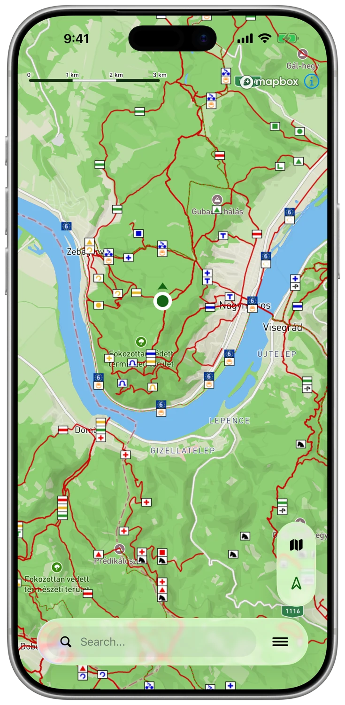
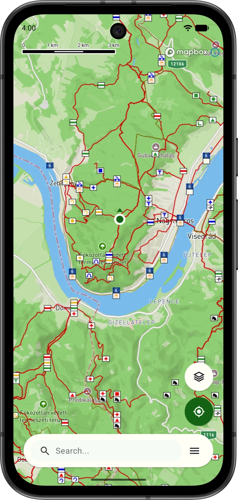

# HuKi-KMP - Hungarian Hiking Map #

[](https://github.com/RolandMostoha/HuKi-KMP/actions/workflows/github-workflow-android.yml)
[](https://github.com/RolandMostoha/HuKi-KMP/actions/workflows/github-workflow-ios.yml)
[](https://apps.apple.com/app/id6794327609)
[](https://github.com/RolandMostoha/HuKi-KMP/commits/main)

HuKi-KMP is a Kotlin Multiplatform project targeting Android and iOS.

It's a hiking app that helps you plan trips and discover the hiking trails of Hungary.

HuKi is my pet project, I develop it in my free time. The app is free, ad-free and open source.

## Releases

**HuKi-iOS** is released and available in App Store: https://apps.apple.com/app/id6794327609

<a href="https://apps.apple.com/app/id6794327609"></a>

**HuKi-Android v2.0 (KMP-based)** is not live yet, it will only replace "legacy" HuKi if the feature set comes
close to the legacy app.

**HuKi-Android v1.x (legacy → will be replaced)** is a live native Android app:

- Implemented under: https://github.com/RolandMostoha/HuKi-Android
- Published on Google Play: https://play.google.com/store/apps/details?id=hu.mostoha.mobile.android.huki

<a href="https://play.google.com/store/apps/details?id=hu.mostoha.mobile.android.huki"></a>

## Screenshots

|                                   iOS                                   |                                   Android                                   |
|:-----------------------------------------------------------------------:|:---------------------------------------------------------------------------:|
|  |  |

## Project Overview

- **Domain**: Hiking application for Hungarian landscapes, trails, destinations.
- **Type**: Kotlin Multiplatform (KMP).
- **Target Platforms**: Android, iOS.
- **KMP approach**: "Do not share UI", so iOS UI is written in SwiftUI.
- **UI Frameworks**: Jetpack Compose for Android, SwiftUi for iOS.
- **Target Platform APIs**:
    - Android: minSdk=26, targetSdk=36
    - iOS: Xcode=26.1.1+, Deployment Target=18.2
- **Project Structure**:
    - `:composeApp`: Android native code.
    - `:iosApp`: iOS native code.
    - `:shared`: Shared kotlin code.
- **Supported app languages**: English, Hungarian.

## Plan board

Refer to [PLANNING.md](tools/planning/PLANNING.md).

## Tech stack & architecture & coding constraints

Refer to [AGENTS.md](AGENTS.md). It's the best place for humans too.

## Supporters

<picture>
  <source media="(prefers-color-scheme: dark)" srcset="tools/assets/graphhopper_logo_dark.svg">
  
</picture>

GraphHopper gives HuKi a very generous free plan to its Routing API.

The Routing API calculates hiking routes between up to 10 stops, with a custom model that prefers Hungarian marked trails, the
shortest walking route and bike routes, all with elevation data for the distance, ascent and descent stats.

Kudos to the GraphHopper team, I appreciate it!

Website link: https://www.graphhopper.com/


LocationIQ gives HuKi a very generous free plan to its Autocomplete and Geocoding APIs.

Huge thanks to the Location IQ team for the opportunity!

Services Used:

- Autocomplete API – Powers place search suggestions throughout the application, helping users quickly find destinations
  and POIs.
- Forward Geocoding API – Converts place names, addresses, and search queries into coordinates.
- Reverse Geocoding API – Powers features where converting coordinates into place information is necessary.

Website link: https://locationiq.com/

## Integration & Delivery

The project uses `GitHub Actions` to ensure code quality.

The following steps are running on the CI server on `main` push:

### Kotlin (shared code) + Android

1. Detekt - Static code analysis for Kotlin code
2. Ktlint - Enforces industry standard Kotlin style & formatting rules
3. Android Lint - Standard Android linter from Google
4. Compose Lints - Lint extension to avoid common Jetpack Compose mistakes
5. Unit tests
6. Android build
7. Android E2E UI tests - Using `Maestro`

```shell
./gradlew detekt ktlintCheck lint test assembleDebug maestro test
```

### iOS

1. SwiftLint - Enforces Swift style and conventions, warnings fail the build (`--strict`)
2. Xcode build
3. iOS E2E UI tests - Using `Maestro`

```shell
swiftlint --strict xcodebuild maestro test
```

## Testing

I'm a big fan of testing so the aim is to be fairly covered with Unit, Instrumentation and UI tests.

### Test types

1. Unit tests
2. Android Instrumentation tests - on-device tests without UI (e.g. Repository tests)
3. E2E tests with Maestro - on-device test with UI

### Unit tests

Kotlin based Unit tests for the shared code, using `Kotest` for assertions and `Turbine` for Flow testing.

**Android:**

```shell
./gradlew test
```

### Instrumentation tests (without UI)

Instrumentation tests are running on emulators/simulators but UI is not involved.

E.g.: Repository tests for DB, networking, files etc.

**Android:**

```shell
./gradlew connectedAndroidTest
```

### E2E UI tests

E2E UI tests require emulator/simulator and UI enabled.

Using `Maestro`, the goal here is "written-once, test both": wherever possible, one UI test case `yaml` is written for
both Android/iOS.

UI test cases are created under: `./.maestro/*.yml`

Running the tests:

```shell
maestro test
```

## Security

### Secrets

API keys live in `secrets.properties` at the repo root (gitignored). Values MUST be quoted:

```
MAPBOX_ACCESS_TOKEN_ANDROID="pk.abc123"
MAPBOX_ACCESS_TOKEN_IOS="pk.def456"
LOCATION_IQ_API_KEY_ANDROID="pk.abc123"
LOCATION_IQ_API_KEY_IOS="pk.def456"
GRAPHHOPPER_API_KEY_ANDROID="abc123"
GRAPHHOPPER_API_KEY_IOS="def456"
HUKI_ROUTING_API_KEY="abc123"
```

The `GenerateSecretsTask` Gradle task turns them into an `expect object Secrets` with an `actual` per platform:

- Keys ending in `_ANDROID` / `_IOS` are exposed without the suffix (`Secrets.MAPBOX_ACCESS_TOKEN`) and compiled
  into their own platform only, so an APK never carries the iOS key and vice versa.
- Every value is XOR-masked with a random key, so it doesn't show up in `strings` / decompiler output.
  This is obfuscation, not encryption: keep the provider-side restrictions below in place too.
- A platform key missing for the platform being built fails the build (`generateSecretsAndroid` / `generateSecretsIos`),
  and so does an unsuffixed key next to its platform variants.

GitHub Actions writes `secrets.properties` from the repo secrets of the same name.

### MapBox

Personal `MapBox` public tokens (`pk.`) are required for the map, one per platform. The token is set in code
(`MapboxOptions.accessToken`) on both platforms, never via `mapbox_access_token.xml` or `MBXAccessToken`.

Token hardening in the Mapbox dashboard: public scopes only (no secret `sk.` scopes), one token per platform,
usage alerts on the account.

### Location IQ

Personal `LocationIQ` tokens are required for geocoding, one per platform: https://locationiq.com

Token hardening in the LocationIQ dashboard: one token per platform, daily request limit per token, usage alerts.

## Licence resources

- OpenStreetMap - https://www.openstreetmap.org/copyright
- Mapbox - Map engine - https://www.mapbox.com/
- Hungarian Hiking Layer (turistautak.openstreetmap.hu) - https://data2.openstreetmap.hu/
- Turistautak - https://turistautak.openstreetmap.hu/
- Location IQ - Search engine -  https://locationiq.com/
- GraphHopper - Route planner API - https://www.graphhopper.com/

## Project License

HuKi is open source, in four parts. Full terms: [NOTICE](NOTICE).

| Part                                                       | License                                                                                                        |
|------------------------------------------------------------|----------------------------------------------------------------------------------------------------------------|
| Source code                                                | [GPL v3.0 or later](LICENSE), with an exception for linking the Mapbox, Firebase and Google Play services SDKs |
| Descriptions, curated destination data, in-app texts       | [CC BY-SA 4.0](https://creativecommons.org/licenses/by-sa/4.0/)                                                |
| "HuKi" name, logo and app icon                             | Not licensed: forks must use a different name and icon                                                         |
| OpenStreetMap data, Blue Trail GPX files, Material Symbols | Their own terms (ODbL, kektura.hu, Apache 2.0)                                                                 |

Versions published before 2026-11-07 were released under the MIT License.

Pull requests are not accepted, but bug reports are welcome: see [CONTRIBUTING.md](CONTRIBUTING.md).
