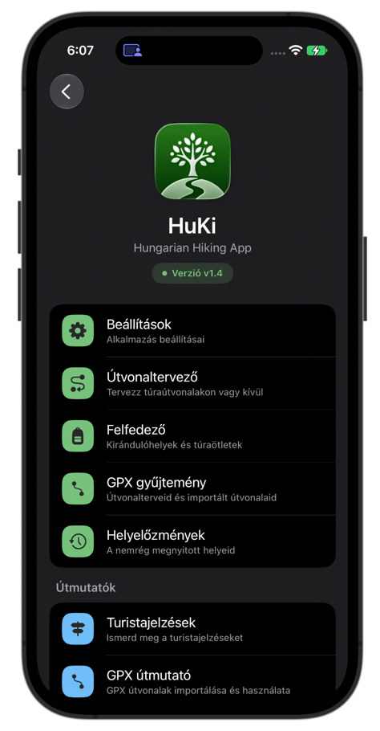
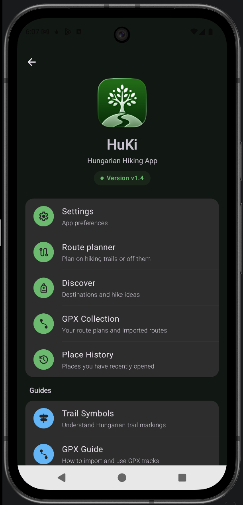
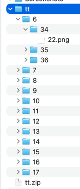

# HuKi-KMP — Plan Board

## Legend

| Status | Meaning                     |
|--------|-----------------------------|
| `[ ]`  | Not started                 |
| `[R]`  | Required for Next Release   |
| `[G]`  | Android 2.0 Go-Live         |
| `[~]`  | In progress                 |
| `[x]`  | Done                        |
| `[-]`  | Cancelled / deprioritized   |
| `[?]`  | Questionable / spike needed |

---

## Most important features in HuKi

1. Map, text visibility
2. My location, GPS accuracy, navigating in trails, battery consumption
3. Layers (especially hiking Layer)
4. Search for places
5. Place Details
6. GPX
7. Route planner
8. Support / Billing
9. Destinations - Locally stored POIs (Peaks, Waterfalls, Valleys etc.)
10. OKT/AKT/RPDDK routes
11. Landscapes
12. Place Category search (peaks, rivers, caves etc.)

## Release plan

### Android Go-live

Android 2.0 Go-Live: will only happen if legacy HuKi's feature set is mostly covered in HuKi-KMP:

- Extra GPX features (e.g. altitude coloring)
- Font/map sizing → this is one of the most used features in legacy
- Support / Billing
- Full-offline mode - to have an incentive to switch
- Place Category → LIQ? Might be dropped entirely, OSM-Overpass data is not too useful because of duplications and
  outdated data

## Backlog

### General / Design / tech tasks

| Status | Feature                                                                                                                                                                                                                                      |
|--------|----------------------------------------------------------------------------------------------------------------------------------------------------------------------------------------------------------------------------------------------|
| `[ ]`  | Android-Design: Theming, coloring fixes, i like ios colors more .                                                                                                                              |
| `[ ]`  | SwiftUi previews don't work atm, because of Mapbox startup init breaks it                                                                                                                                                                    |
| `[ ]`  | App store preview video (optional)                                                                                                                                                                                                           |
| `[ ]`  | App store header picture/video (optional)                                                                                                                                                                                                    |
| `[ ]`  | iPhone duo / proper iPad support                                                                                                                                                                                                             |
| `[ ]`  | Distribution cert expires **2027-08-20** → re-export `.p12` and update the secret (or migrate to `match` then)                                                                                                                               |
| `[?]`  | Android remove shadows from UI elements -> Material recommends separate by colors, not shadows.                                                                                                                                              |

### Bugs

| Status | Scope      | Bug                                                                                                                                                                                                                                                                                                                                                                                                     |
|--------|------------|---------------------------------------------------------------------------------------------------------------------------------------------------------------------------------------------------------------------------------------------------------------------------------------------------------------------------------------------------------------------------------------------------------|
| `[ ]`  | MyLocation | There is no hard timeout for a location fix. If My Location button is clicked and location fix doesnt come, it loads inifinitely. After a fixed timeout, we should show an alert "Couldn't find location, try again later"                                                                                                                                                                              |
| `[ ]`  | Map        | Bug: iOS. With the Standard (City) base layer, closing the Layers sheet flashes the map empty for a few frames right after the dismiss animation, then it redraws. Satellite/Outdoors don't flash.                                                                                                                                                                                                      |
| `[ ]`  | GPX        | Bug: Travel time. `naismith()` downhill corrections never apply: `atan(slope)` is in radians but compared to -5 / -12 degrees, so descents are timed like flat ground.                                                                                                                                                                                                                                  |
| `[?]`  | Settings   | Bug: (Could repro only once) Android and iOS?. 1. For waypoints the infow window is not shown by default. 2. Roundtrip GPX file shows 0m 0min for the ROUNTRIP POI.                                                                                                                                                                                                                                     |

### Design

| Status | Scope          | Bug                                                                                              |
|--------|----------------|--------------------------------------------------------------------------------------------------|
| `[ ]`  | Landscapes&OKT | Slow down the section / landscape animations, moving from section to section happens too quickly |

### FEATURE: Analytics

| Status | Scope     | Task                                                                                                                |
|--------|-----------|---------------------------------------------------------------------------------------------------------------------|
| `[ ]`  | Analytics | My Location: No-signal / GPS lost                                                                                   |
| `[ ]`  | Analytics | Search with no results                                                                                              |
| `[ ]`  | Analytics | GPX as params: attach distance_km and waypoint_count as params                                                      |
| `[ ]`  | Analytics | whats_new_shown, whats_new_dismissed                                                                                |
| `[ ]`  | Analytics | Offline - somehow monitor if user goes offline -> really helpful measurement, how many ppl experiencing it on hikes |

### FEATURE: Map

| Status | Scope | Task                                                                                                                                                               |
|--------|-------|--------------------------------------------------------------------------------------------------------------------------------------------------------------------|
| `[ ]`  | Map   | For people with poor vision, create a "high-contrast" version, which add more visibility to labels, map elements.                                                  |

### FEATURE: Landscape orientation

| Status | Feature                                                                                                                        |
|--------|--------------------------------------------------------------------------------------------------------------------------------|
| `[ ]`  | Android: Add Previews to Landscape / Tablet view                                                                               |
| `[ ]`  | iOS-Landscape: Mapbox scale bar should be less wide (Android works fine, Mapbox had a built-in option)                         |
| `[ ]`  | iOS-Landscape: Mode, use Glass Panel for Layers Sheets instead of full screen sheet.                                           |
| `[ ]`  | iOS-iPad: Use overlay side panels instead of Sheets -> they show up in the center of the screen covering lots of usable space  |
| `[ ]`  | Add extra padding to floating action in iPad mode, there is a lot of space                                                     |
| `[ ]`  | Landscapes/Categories sheet: proper landscape support on both platforms (rotation while open, detents/heights, camera padding) |
| `[?]`  | iOS-Landscape: Move the sheet to left to match Apple Maps behavior, so Map is more visible in the right side                   |

### FEATURE: My Location

| Status | Scope      | Task                                                                                                                                                                                                                                                                  |
|--------|------------|-----------------------------------------------------------------------------------------------------------------------------------------------------------------------------------------------------------------------------------------------------------------------|
| `[ ]`  | MyLocation | Location permission rationale screen: show a "why we need location" priming screen before the OS prompt (and a denied → open-Settings recovery path). Location permission has a 33% blind spot. 213 granted, 10 denied_always, and 110 users (33%) never fire either. |

### FEATURE: Search

| Status | Scope  | Task                                                                                   |
|--------|--------|----------------------------------------------------------------------------------------|
| `[ ]`  | Search | No mic/voice icon. Search by voice Consider adding one between the text and hamburger. |
| `[ ]`  | Search | In-memory LRU cache keyed by Request                                                   |

### FEATURE: Destinations

| Status | Scope        | Task                                                                                                                                  |
|--------|--------------|---------------------------------------------------------------------------------------------------------------------------------------|
| `[ ]`  | Destinations | Add VIA FERRATA as challenge                                                                                                          |
| `[ ]`  | Destinations | Kisvasutak: Show waypoints. GPX generation is ready: `generate-scenic-railway-gpx` skill (`tools/python/generate_scenic_railways.py`) |

### FEATURE: Discover

| Status | Scope    | Task |
|--------|----------|------|
| `[ ]`  | Discover |      |

### FEATURE: OKT

| Status | Scope | Task |
|--------|-------|------|
| `[ ]`  | OKT   |      |

### FEATURE: Versioning + WhatsNew

| Status | Scope    | Task                                                                                                                                                                                               |
|--------|----------|----------------------------------------------------------------------------------------------------------------------------------------------------------------------------------------------------|
| `[ ]`  | WhatsNew | Add "Follow on Facebook" section to WhatsNew's bottom.                                                                                                                                             |
| `[ ]`  | WhatsNew | Version history screen under Settings: list every release + date + notes (uses the full `releases` list).                                                                                          |

### FEATURE: GPX

| Status | Scope | Task                                                                                                                                 |
|--------|-------|--------------------------------------------------------------------------------------------------------------------------------------|
| `[ ]`  | GPX   | Display waypoint comments in a window                                                                                                |
| `[?]`  | GPX   | Also: Auto-detect direction next to manual setup                                                                                     |

### FEATURE: GPX Collection

| Status | Scope         | Task                                                                                                                                                                                                                                                                                                                                                                           |
|--------|---------------|--------------------------------------------------------------------------------------------------------------------------------------------------------------------------------------------------------------------------------------------------------------------------------------------------------------------------------------------------------------------------------|
| `[ ]`  | GPXCollection | Reduce the landsacpes text size, like "Börzsöny, Dunakanyar" -> "Börzsöny"                                                                                                                                                                                                                                                                            |
| `[ ]`  | GPXCollection | Implement rename file                                                                                                                                                                                                                                                                                                                                                          |
| `[ ]`  | GPXCollection | Searchbar, free search text by gpx name                                                                                                                                                                                                                                                                                                                                        |
| `[ ]`  | GPXCollection | "Mark Completed" GPX files. Updated metadata schema.                                                                                                                                                                                                                                                                                                                           |
| `[ ]`  | GPXCollection | Bulk import multiple GPX files: "Import" button in the top bar + empty state, multi-select picker (Android `OpenMultipleDocuments`, iOS `.fileImporter(allowsMultipleSelection: true)`), shared `FilesImported(uris)` event looping `readGpxFile`, keep going on failures, "Imported X of Y" result, count-only analytics. Later: `ACTION_SEND_MULTIPLE` / iOS document types. |

### FEATURE: Place Details

| Status | Scope        | Task                                                                                                                                               |
|--------|--------------|----------------------------------------------------------------------------------------------------------------------------------------------------|
| `[ ]`  | PlaceDetails | iOS: open shared locations via a Share Extension (Google Maps / Apple Maps links), iOS Photos always opens Apple Maps                              |
| `[ ]`  | Landscapes   | `huki.hu/landscape?id=` (and legacy `osmId=`) App Link opens the landscape, as in HuKi-Android                                                     |
| `[ ]`  | PlaceDetails | Allow dragging the marker to refine the pick (re-geocode on drop)                                                                                  |

### FEATURE: PlaceHistory

| Status | Scope        | Task                                                                                |
|--------|--------------|-------------------------------------------------------------------------------------|
| `[ ]`  | PlaceHistory | Add the PlaceSource indicator (long-tap, destinations etc.) to place history screen |

### FEATURE: Route Planner

| Status | Scope        | Task                                                                                                                                                                                                                                                                                |
|--------|--------------|-------------------------------------------------------------------------------------------------------------------------------------------------------------------------------------------------------------------------------------------------------------------------------------|
| `[ ]`  | RoutePlanner | Add an eye icon to route plan so you can "look behind" the plan and see where the hikings routes are.                                                                                                                                                                               |
| `[ ]`  | RoutePlanner | Add guard if "Route Plan" next destination is too far away >50km -> Show a warning message, the stop is too far away                                                                                                                                                                |
| `[ ]`  | RoutePlanner | In-memory LRU cache keyed by RoutePlanRequest (profile + waypoints),                                                                                                                                                                                                                |
| `[ ]`  | RoutePlanner | Dedicated iPad support so the sheet does not open in the middle, but in the bottom left corner.                                                                                                                                                                                     |
| `[?]`  | RoutePlanner | Android: a long/fast swipe down on the planner sheet targets Hidden, which the dismiss guard rejects, so it snaps back to expanded instead of minimizing. A moderate drag minimizes correctly.                                                                                      |
| `[?]`  | RoutePlanner | Add support for removing stops from Map during RoutePlan phase. If users click on the wps, there should be a toolbar "Delete Stop" button, which removes the waypoint.                                                                                                              |
| `[?]`  | RoutePlanner | Add support for converting to round trip through MAP. If users click on the START WP, there should be a toolbar "Finish with round trip" button, which adds the first wp as the last one.                                                                                           |
| `[?]`  | RoutePlanner | Pre-warm: call `/health` once remaining drops below the reserve, to hide the ~6 s cold start                                                                                                                                                                                        |
| `[?]`  | RoutePlanner | Remote Config (`routing_mode`, `gh_credit_reserve`) — needs Firebase Remote Config on both Android and iOS first; defaults in code                                                                                                                                                  |

### FEATURE: Menu & Settings

| Status | Scope    | Task                                                      |
|--------|----------|-----------------------------------------------------------|

### FEATURE: Menu - Guides

Goal: a new section in Menu, with 1 page guides of different topics.

| Status | Scope  | Task                                                                                                                                              |
|--------|--------|---------------------------------------------------------------------------------------------------------------------------------------------------|
| `[ ]`  | Guides | Add "Problem on route" to Guides section.                                                                                                         |
| `[ ]`  | Guides | Add a section for "Slope coloring" and "Travel Time calculation" to Guides section.                                                               |

#### Guides: Report problem on route

- Use MTSZ (Magyar Természetjáró Szövetség) email's to report a problem
- Include location (latitude, longitude)
- Possible link to openstreetmap.org which include the problematic point

### FEATURE: Support + Billing

- Support + Billing is necessary to help me keep the app free for everyone and support the development.
- Google: Google Play Billing API
- Apple: Apple App Store Connect, Apple Pay
- Base concept: subscriptions and one time payments. Categorized by wild animals (e.g. Board=1EUR/month, Owl=1EUR).
- The benefit of supporting is just visual: showing the supporter animal in various places (e.g. WhatsNew)

| Status | Scope   | Task                                                                                                                                                                                                                                                                                                                                                                                                   |
|--------|---------|--------------------------------------------------------------------------------------------------------------------------------------------------------------------------------------------------------------------------------------------------------------------------------------------------------------------------------------------------------------------------------------------------------|
| `[ ]`  | Support | If the user is supporter, implement an easter egg. At random times (make it rare), show the chosen animal as a POI in the map. It should have a reveal animation, with a drop shadow. Sg like: . On click it shows a thanks info window and dismisses shortly after.                                                                                                          |

Lets plan the support strategy for Android (google-play-billing) - iOS().

## Ideas / Experimental features

### Hosting our own tile server for hiking layer

- Actual tile server is "https://a.tile.openstreetmap.hu/tt/{z}/{x}/{y}.png"
- The main idea is to host our own tile server for hiking layer and switch from actual
- Hiking layer can be downloaded from: https://data2.openstreetmap.hu/index.php
- TuraReteg.sqlitedb, ttszin.zip, tt.zip etc. 
- Create a tile server based on the tile PNGs
- Set periodic sync for the tiles e.g. 2 weeks
- Check validity of the idea - can this improve the app? better response times? better caching? more reliable? cost? cloud setup? google vs AWS?

| Goal                   | Gain       | Why                                                                                                                                                                         |
|------------------------|------------|-----------------------------------------------------------------------------------------------------------------------------------------------------------------------------|
| Caching                | None       | Already solved by `OverlayTileCacheInterceptor`. Own server could set `Cache-Control` itself and drop the interceptor.                                                      |
| Response time          | Medium     | Current server: HTTP/1.1, TLS 1.2, no HTTP/3, ~130 ms per tile. On weak trail signal the extra round trips add seconds to first loads. No gain offline or for cached tiles. |
| Reliability            | Big        | Today the layer depends on a single volunteer server (Ubuntu 16.04). If it goes down, the main feature breaks.                                                              |
| Load on the volunteers | Big        | All HuKi traffic moves off their server.                                                                                                                                    |
| Offline mode           | Big, later | Own copy of the full layer (`tt.zip` is 371 MB) makes "download the hiking layer for Hungary" possible.                                                                     |

### FEATURE: Favorite POIs

- Mark POIs as favorites (long-tap on map, destinations etc., any POI).
- Favourites record the geocoded name and optional comment
- Make grouping possible, e.g. "Kedvenc túráim", "Gomba gyűjtő helyek".
- Add export to GPX option.

### FEATURE: Full offline mode with downloaded Mapbox layers + Hiking layer

Hiking layer https://data2.openstreetmap.hu/ - TuraReteg.sqlitedb

### FEATURE: Route recording and saving it as GPX file

#### FEATURE: Haptic warning for going off the GPX route

No "Always" / `ACCESS_BACKGROUND_LOCATION` needed: the user starts the session in the foreground, "While Using" carries over.

- Detection (`commonMain`): distance to nearest point on the GPX track, hysteresis (off route > 50 m, back on track < 30 m),
  skip checks on poor accuracy, match the nearby track part only (loops, out-and-back tracks). Alert only on state change.
- iOS: `UIBackgroundModes` → `location`, `allowsBackgroundLocationUpdates = true`, `CLBackgroundActivitySession` (iOS 17+).
  Blue status bar indicator; App Review needs a background mode justification.
- iOS haptics: `UIFeedbackGenerator` is foreground only → use a local notification (notification permission, system
  vibration) or a Live Activity alert (`alertConfiguration`). No custom haptic patterns while locked.
- Android: foreground service, type `location`, started from the foreground. `FOREGROUND_SERVICE` +
  `FOREGROUND_SERVICE_LOCATION` + `VIBRATE` (install-time), `POST_NOTIFICATIONS` (Android 13+ runtime, service runs even if
  denied). Any vibration pattern possible. Play Console foreground service type declaration (video).
- Battery: `distanceFilter` ~10–20 m, skip the check when not moving.

### FEATURE: Route Planner: Wandering mode

Goal: Set a single starting point (e.g. parking), and show the straight line distance from the point. Works like a GPX
with waypoints only, set a few points and leave the user to decide which route to follow.

### FEATURE: GPX Info Panel (remaining time, distance, elevation gain/loss)

| Status | Scope    | Task                                           |
|--------|----------|------------------------------------------------|
| `[ ]`  | GpxPanel | Use GPX panel on Start / GPX Details -> hidden |
| `[ ]`  | GpxPanel | Elapsed time                                   |
| `[ ]`  | GpxPanel | Distance from Start                            |
| `[ ]`  | GpxPanel | Distance from End                              |
| `[ ]`  | GpxPanel | AVG Speed                                      |
| `[ ]`  | GpxPanel | Expected arrival based on dist/AVG speed       |

### FEATURE: iOS Live Activity (lock screen + Dynamic Island)

iOS counterpart of Android's show-when-locked: iOS can't show the app over the lock screen, so a Live Activity (ActivityKit)
shows live hike info there instead, like Apple Maps navigation. Depends on Background location monitoring and the GPX Info Panel.

| Status | Scope        | Task                                                                                                                          |
|--------|--------------|-------------------------------------------------------------------------------------------------------------------------------|
| `[ ]`  | LiveActivity | Widget extension target + `NSSupportsLiveActivities`, user can disable it in iOS Settings                                     |
| `[ ]`  | LiveActivity | Start on opened GPX / my location follow, on clear / stop                                                                     |
| `[ ]`  | LiveActivity | Content: distance left, elapsed time, altitude, next waypoint (no live Mapbox map, `ContentState` ~4 KB, static snapshot max) |
| `[ ]`  | LiveActivity | Updates while locked need background location mode ('While Using' is enough, no "Always") + App Review justification          |
| `[ ]`  | LiveActivity | Privacy: shown to anyone on the lock screen, no GPX names / precise places unless the user opts in                            |
| `[ ]`  | LiveActivity | 8 h active limit (+4 h on lock screen), handle expiry for long hikes                                                          |

### FEATURE: Camera panel

Inspired by the debug camera panel (DEBUG_CAMERA_PANEL_ENABLED), add this as a usable feature for users. This might be useful, they can record their
exact location / zoom level with a CROSS marker.

### FEATURE: GPX Collection Import/Export (device-to-device, no cloud)

Goal: share/back up the whole GPX collection between devices without cloud or auth. Principle: separate **format** (a
portable collection file) from **transport** — let the OS own transport (AirDrop, Quick Share, Bluetooth, Files/USB,
email, chat). A zipped bundle is plain data, so an Android export imports on iOS and vice-versa.

| Status | Scope      | Task                                                                                                    |
|--------|------------|---------------------------------------------------------------------------------------------------------|
| `[ ]`  | GPX Export | `GpxCollectionArchiver` (expect/actual): zip `gpx/external` + generated `manifest.json`                 |
| `[ ]`  | GPX Export | Export action → native share sheet (iOS ShareLink / Android ACTION_SEND + FileProvider)                 |
| `[ ]`  | GPX Import | `GpxCollectionArchiver` unzip to temp, then loop each `.gpx` through `GpxStorage.saveToFileSystem`      |
| `[ ]`  | GPX Import | iOS: declare imported/exported UTI + `CFBundleDocumentTypes`, handle inbound via `.onOpenURL`           |
| `[ ]`  | GPX Import | Android: `<intent-filter>` ACTION_VIEW/ACTION_SEND for `.hukigpx`/zip, read URI in `onNewIntent`        |
| `[x]`  | GPX Import | Android: open plain `.gpx` files from other apps (email attachments, file managers), as in HuKi-Android |
| `[ ]`  | GPX Import | Extend existing file pickers to also accept `.hukigpx`/`.zip`                                           |
| `[ ]`  | GPX Import | Manifest-driven import preview/summary ("X new, Y duplicates")                                          |
| `[ ]`  | GPX Import | iOS unzip needs a lib (ZIPFoundation via SPM or libarchive); Android uses `java.util.zip`               |

### FEATURE: Hike Finder

Goal: Create a search engine for hiking routes which have downloadable GPX files. The crawler parses the most important
HU hiking sites:

- aktivkalandor
- kirandulastippek
- mozgasvilag
- termeszetjaro

Input: the user can search a route by

- location / area
- distance (e.g. routes around 10km)
- difficulty Output: a list with links pointing to the route article inside the website.

Example:
Input: Dobogókő area, 10km, medium difficulty Output:

- https://kirandulastippek.hu/budapest-kornyeke/dobogoko
- https://www.mozgasvilag.hu/turazas/turautak/szep-kilatasos-pilisi-cukitura-dobogokore-es-vissza
- https://www.termeszetjaro.hu/hu/tour/gyalogtura/dobogoko-ket-arca-az-eszaki-vadregenybol-a-deli-napos-oldalra/36765072/

Keep in mind:

- Comply with website terms and conditions
- All websites should be asked to participate / allow after POC is done
- Do not store the GPX files, or any legal/proprietary data
- App just redirects the user to the link in a browser

- Create a crawler for hiking collection websites (Term, AktivM etc.).
- Create a DB based on the crawled info.
- Build a search engine on top of it.

### FEATURE: HuKi Guesser

GeoGusesser game for HuKi.

---

## Completed

| Feature        | Notes                                                        |
|----------------|--------------------------------------------------------------|
| Map            | Mapbox                                                       |
| My location    | Mapbox + Google Fused Location Provider                      |
| Layers         | Mapbox Outdoor, Street, Satellite, Hiking                    |
| Search         | Place Autocomplete, Destinations, Recent GPXs, Recent Places |
| Menu           | Features, Contact, Supporters                                |
| GPX            | GPX Import, Layers                                           |
| GPX Details    | GPX Details Sheet with basic info, Maps Navigation           |
| GPX Menu       | GPX Visibility, Overview, Clear, Distances                   |
| GPX Collection | GPX File list view, GPX Tutorial screen                      |
| GPX Metadata   | Store GPX Metadata in a JSON                                 |
| Place History  | Place History list view                                      |
| Destinations   | Destinations with Popular, Ladnscapes, Nearby                |
| WhatsNew       | Versioning, WhatsNew Sheet                                   |
| Guides         | GPX Guide, Trail Symbols Guide                               |
