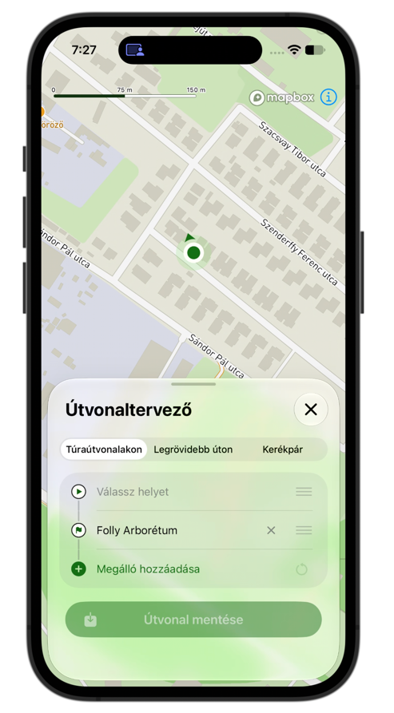

# HuKi-KMP — Plan Board

## Legend

| Status | Meaning                     |
|--------|-----------------------------|
| `[ ]`  | Not started                 |
| `[R]`  | Required for Next Release   |
| `[~]`  | In progress                 |
| `[x]`  | Done                        |
| `[-]`  | Cancelled / deprioritized   |
| `[?]`  | Questionable / spike needed |

---

## Most important features in HuKi

1. Map, text visibility
2. My location, GPS accuracy, navigating in trails, battery consumption
3. Layers (especially hiking Layer)
4. Search for places
5. Place Details
6. GPX
7. Route planner
8. Support / Billing
9. Destinations - Locally stored POIs (Peaks, Waterfalls, Valleys etc.)
10. OKT/AKT/RPDDK routes
11. Landscapes
12. Place Category search (peaks, rivers, caves etc.)

## Release plan

### Android Go-live

Android 2.0 Go-Live: will only happen if legacy HuKi's feature set is mostly covered in HuKi-KMP:

- Extra GPX features (e.g. altitude coloring)
- Support / Billing
- Font/map sizing → this is one of the most used features in legacy
- Full-offline mode - to have an incentive to switch
- Place Category → LIQ? Might be dropped entirely, OSM-Overpass data is not too useful because of duplications and outdated data

## Backlog

### General / tech tasks

| Status | Feature                                                                                                                                            |
|--------|----------------------------------------------------------------------------------------------------------------------------------------------------|
| `[ ]`  | Android remove shadows from UI elements -> Material recommends separate by colors, not shadows.                                                    |
| `[ ]`  | SwiftUi previews don't work atm, because of Mapbox startup init breaks it                                                                          |
| `[ ]`  | App store preview video (optional)                                                                                                                 |
| `[ ]`  | App store header picture/video (optional)                                                                                                          |
| `[ ]`  | iPhone duo / proper iPad support                                                                                                                   |
| `[ ]`  | Distribution cert expires **2027-08-20** → re-export `.p12` and update the secret (or migrate to `match` then)                                     |

### Bugs

| Status | Scope        | Bug                                                                                                                                                                                                                                                                                                             |
|--------|--------------|-----------------------------------------------------------------------------------------------------------------------------------------------------------------------------------------------------------------------------------------------------------------------------------------------------------------|
| `[ ]`  | Search       | Bug: Android. DestinationsSection->overscrollEffect = null is used because of this bug. LazyRow shows spurious stretch-overscroll mid-list on fling (cards widen/shake even when not at an edge). Only on fling, not on controlled drag (scroll-to-stop). (possibly a Compose foundation fling/overscroll bug). |
| `[ ]`  | Search       | Bug: Android. Sheets closing animations dont work clicing on X, it just flashes down.                                                                                                                                                                                                                           |
| `[ ]`  | MyLocation   | There is no hard timeout for a location fix. If My Location button is clicked and location fix doesnt come, it loads inifinitely. After a fixed timeout, we should show an alert "Couldn't find location, try again later"                                                                                      |
| `[ ]`  | Map          | Bug: iOS. With the Standard (City) base layer, closing the Layers sheet flashes the map empty for a few frames right after the dismiss animation, then it redraws. Satellite/Outdoors don't flash.                                                                                                              |
| `[R]`  | RoutePlanner | If I choose a far away destination, and click on route plan, it moves the camera to my location. The route planner correclty shows the destination and my location is correclty not present in the route plan, but my camera is moved to my location.                                    |

### FEATURE: Map

| Status | Scope | Task                                                                              |
|--------|-------|-----------------------------------------------------------------------------------|
| `[ ]`  | Map   | After state restoration / app kill -> restore last camera state + last opened GPX |
| `[ ]`  | Map   | Bug: GPX Menu -> Overview -> applies a big bottom padding, not necessary          |
| `[ ]`  | Map   | Is there any optimization strategy for raster layers? HuKi-hiking trails          |

### FEATURE: Camera panel

Inspired by DEBUG_SHOW_CAMERA_PANEL, add this as a usable feature for users. This might be useful, they can record their
exact location / zoom level with a CROSS marker.

### FEATURE: Dark Mode

| Status | Scope | Bug |
|--------|-------|-----|
| `[ ]`  |       |     |

### FEATURE: Landscape orientation

| Status | Feature                                                                                                                        |
|--------|--------------------------------------------------------------------------------------------------------------------------------|
| `[ ]`  | Android: Add Previews to Landscape / Tablet view                                                                               |
| `[ ]`  | iOS-Landscape: Mapbox scale bar should be less wide (Android works fine, Mapbox had a built-in option)                         |
| `[ ]`  | iOS-Landscape: Mode, use Glass Panel for Layers Sheets instead of full screen sheet.                                           |
| `[?]`  | iOS-Landscape: Move the sheet to left to match Apple Maps behavior, so Map is more visible in the right side                   |
| `[ ]`  | iOS-iPad: Use overlay side panels instead of Sheets -> they show up in the center of the screen covering lots of usable space  |
| `[ ]`  | Add extra padding to floating action in iPad mode, there is a lot of space                                                     |
| `[ ]`  | Landscapes/Categories sheet: proper landscape support on both platforms (rotation while open, detents/heights, camera padding) |

### FEATURE: My Location

| Status | Scope      | Task                                                                                                                                                                                                                                                                  |
|--------|------------|-----------------------------------------------------------------------------------------------------------------------------------------------------------------------------------------------------------------------------------------------------------------------|
| `[ ]`  | MyLocation | Show altitude somewhere                                                                                                                                                                                                                                               |
| `[ ]`  | MyLocation | Location permission rationale screen: show a "why we need location" priming screen before the OS prompt (and a denied → open-Settings recovery path). Location permission has a 33% blind spot. 213 granted, 10 denied_always, and 110 users (33%) never fire either. |

### FEATURE: Layers

| Status | Scope  | Task                                                                                                                                                                                                                                                                                                                             |
|--------|--------|----------------------------------------------------------------------------------------------------------------------------------------------------------------------------------------------------------------------------------------------------------------------------------------------------------------------------------|
| `[?]`  | Layers | Draw the hiking (turistautak) raster below the base map labels so place/peak names (e.g. "Szilvási-kő") stay readable. Outdoors: `GenericStyle(layerPositionedContent = { belowLayer(...) })` / iOS `.position(.below(...))`; Standard/Satellite: `middle` slot. Check trail visibility vs. road/contour labels and tap targets. |

### FEATURE: Search

| Status | Scope  | Task                                                                                                                                              |
|--------|--------|---------------------------------------------------------------------------------------------------------------------------------------------------|
| `[ ]`  | Search | No mic/voice icon. Search by voice Consider adding one between the text and hamburger.                                                            |
| `[ ]`  | Search | In-memory LRU cache keyed by Request                                                                                                              |
| `[x]`  | Search | Reduce Recent GPX section from 3 to 2 items, so Nearby destinations moves up toward the fold. Keep Recent places at 3 (most-used sheet shortcut). |
| `[R]`  | Search | Analytics: log "Show all" taps as separate events: `search_see_all_places`, `search_see_all_gpx`, `search_see_all_destinations`.                  |

### FEATURE: Destinations

| Status | Scope        | Task                                                                                                                                                                                                                                                                           |
|--------|--------------|--------------------------------------------------------------------------------------------------------------------------------------------------------------------------------------------------------------------------------------------------------------------------------|
| `[x]`  | Destinations | Remove "Destinations" from Menu, because they are already available through "Discover". Remove "Kozel 400 kezzel valogatott hely" string from the app. Modify subtitle "Túraötletek és kirándulóhelyek" - "Kirándulóhelyek és túraötletek". Also adjust Maestro and unit tests |
| `[x]`  | Destinations | Reorder Discover sheet. 1. Destinations 2. Hike recommendations 3. OKT                                                                                                                                                                                                         |
| `[ ]`  | Destinations | Add VIA FERRATA as challenge                                                                                                                                                                                                                                                   |
| `[ ]`  | Destinations | Kisvasutak: Show waypoints. GPX generation is ready: `generate-scenic-railway-gpx` skill (`tools/python/generate_scenic_railways.py`)                                                                                                                                          |

### FEATURE: Discover

| Status | Scope    | Task |
|--------|----------|------|
| `[ ]`  | Discover |      |

### FEATURE: OKT

| Status | Scope | Task |
|--------|-------|------|
| `[ ]`  | OKT   |      |

### FEATURE: Versioning + WhatsNew

| Status | Scope    | Task                                                                                                                                           |
|--------|----------|------------------------------------------------------------------------------------------------------------------------------------------------|
| `[R]`  | WhatsNew | Bug: When we have only a few 1-2 lines of whatsnew, the sheet feels too spacey . It should be resized based on the content. |
| `[ ]`  | WhatsNew | Add "Follow on Facebook" section to WhatsNew's bottom.                                                                                         |
| `[ ]`  | WhatsNew | Version history screen under Settings: list every release + date + notes (uses the full `releases` list).                                      |

### FEATURE: GPX

| Status | Scope | Task                                                                                                                                        |
|--------|-------|---------------------------------------------------------------------------------------------------------------------------------------------|
| `[ ]`  | GPX   | Colored GPX                                                                                                                                 |
| `[ ]`  | GPX   | Display direction arrows. Add an option to toggle direction in GpxMenu                                                                      |
| `[ ]`  | GPX   | Display waypoint name in the info window (above distance and travel time)                                                                   |
| `[ ]`  | GPX   | Display waypoint comments in a window                                                                                                       |
| `[ ]`  | GPX   | Gpx Edit function -> reloads all waypoints in route planner. Only for HuKi plans should work, other GPX might be under licence obligations. |
| `[ ]`  | GPX   | ? Display start and end location: "Around Bükk..." -> on import we can do geocode                                                           |

### FEATURE: GPX Collection

| Status | Scope         | Task                                         |
|--------|---------------|----------------------------------------------|
| `[ ]`  | GPXCollection | Implement rename                             |
| `[ ]`  | GPXCollection | Searchbar, free search text by gpx name      |
| `[ ]`  | GPXCollection | Filter by distance, open date, per landscape |
| `[ ]`  | GPXCollection | "Mark Completed" GPX files                   |

### FEATURE: Place Details

| Status | Scope        | Task                                                              |
|--------|--------------|-------------------------------------------------------------------|
| `[ ]`  | PlaceDetails | Search nearby button                                              |
| `[ ]`  | PlaceDetails | Allow dragging the marker to refine the pick (re-geocode on drop) |

### FEATURE: PlaceHistory

| Status | Scope        | Task                                                                                |
|--------|--------------|-------------------------------------------------------------------------------------|
| `[ ]`  | PlaceHistory | Add the PlaceSource indicator (long-tap, destinations etc.) to place history screen |

### FEATURE: Route Planner

| Status | Scope        | Task                                                                                                                                                                                                                                                                       |
|--------|--------------|----------------------------------------------------------------------------------------------------------------------------------------------------------------------------------------------------------------------------------------------------------------------------|
| `[ ]`  | RoutePlanner | Android: the planner loses its stops on a configuration change (rotation, dark-mode toggle) — `rememberScopedViewModelStoreOwner` does not survive one. Fix with `rememberViewModelStoreOwner` once the project is on AGP 9.1 / compileSdk 37 (androidx.lifecycle 2.11.0). |
| `[ ]`  | RoutePlanner | Android: a long/fast swipe down on the planner sheet targets Hidden, which the dismiss guard rejects, so it snaps back to expanded instead of minimizing. A moderate drag minimizes correctly.                                                                             |
| `[ ]`  | RoutePlanner | Add guard if "Route Plan" next destination is too far away >50km -> Show a warning message, the stop is too far away                                                                                                                                                       |
| `[ ]`  | RoutePlanner | In-memory LRU cache keyed by RoutePlanRequest (profile + waypoints),                                                                                                                                                                                                       |
| `[ ]`  | RoutePlanner | Add an eye icon to route plan so you can "look behind" the plan and see where the hikings routes are.                                                                                                                                                                      |
| `[ ]`  | RoutePlanner | Dedicated iPad support so the sheet does not open in the middle, but in the bottom left corner.                                                                                                                                                                            |
| `[R]`  | RoutePlanner | Support placing multiple place details POI and wire them with Route Planner. Add a counter text e.g. "Route plan (3)" indicating how many POIs will be connected with route plan.                                                                                          |
| `[?]`  | RoutePlanner | Add support for removing stops from Map during RoutePlan phase. If users click on the wps, there should be a toolbar "Delete Stop" button, which removes the waypoint.                                                                                                     |
| `[?]`  | RoutePlanner | Add support for converting to round trip through MAP. If users click on the START WP, there should be a toolbar "Finish with round trip" button, which adds the first wp as the last one.                                                                                  |

### FEATURE: RoutePlanner: HuKi-Routing overflow fallback

Goal: when the hosted GraphHopper API hits its daily limit (2500 credits, HTTP 429), retry the route on our self-hosted
**HuKi-Routing** (Cloud Run, scale-to-zero) instead of showing the limit-reached error. GraphHopper stays the primary
backend because it is global; HuKi-Routing only covers Hungary. Sep 2026: ~800 of 41.5k monthly requests overflowed, all
on weekends, and the weekend peaks are growing.

- URL: `https://huki-routing-550684341915.europe-west1.run.app` (`/route`, same API as GraphHopper)
- Auth: `X-HuKi-Key` header. Key:
  `gcloud secrets versions access latest --secret huki-routing-api-key --project huki-c8bc7`. **Never** as a `?key=`
  query param, because the server logs request URLs.
- Request shape differs from the hosted API: `profile=hike_huki` for Hike/RoundTrip, `hike` for Foot, **no
  `custom_model`** (the trail bias is baked in). Round trip still needs `ch.disable=true`.
- Cold start ~6 s when idle (then ~0.3 s per route). Any request wakes it, `/health` included (no key needed).
- Outside Hungary it fails fast with **HTTP 400** and never returns a wrong route. Tested live:

  | Waypoints                                                     | Response                                                     |
  |---------------------------------------------------------------|--------------------------------------------------------------|
  | Inside HU, or just across the border (Štúrovo)                | 200                                                          |
  | Inside the bbox, no data (Vienna, Bratislava, Subotica, Rust) | 400 `PointNotFoundException` — `Cannot find point 1`         |
  | Outside the bbox (Graz)                                       | 400 `PointOutOfBoundsException` — `Point 1 is out of bounds` |

  Both are in `hints[].details`, with `point_index` = the failing waypoint. Graph bbox: lon 16.09–22.94, lat
  45.71–48.60.

**Design: client-side circuit breaker** (decided 2026-10-06). Not a plain retry-on-429: that would send every request to
GraphHopper first after the limit, ~500 wasted 429s on a day like Oct 3. Not Remote Config as the main switch either:
someone would have to flip it, reading GraphHopper's remaining credits from a server costs a credit per check, config
fetches are slow, and one global switch would also cut off routes abroad.

GraphHopper returns the limit on every response (verified):
`x-ratelimit-limit: 2500`, `x-ratelimit-remaining`, `x-ratelimit-reset` (seconds until reset at 00:00 UTC),
`x-ratelimit-credits` (cost of the request, 1 per route).

```
route(request):
  inHungary = all waypoints inside the bbox above

  if now < ghBlockedUntil:                         // already got a 429 today
      return inHungary ? huki(request) : limitReached()
  if inHungary && freshRemaining < GH_CREDIT_RESERVE:   // keep the last credits for routes abroad
      return huki(request)

  response = graphhopper(request)                  // store remaining + reset + timestamp
  if response is 429:
      ghBlockedUntil = now + x-ratelimit-reset     // persisted, survives app restarts
      return inHungary ? huki(request) : limitReached()
  return response

huki fails (400 PointNotFound/PointOutOfBounds, network, 5xx) → limitReached()
```

- At most **one wasted GraphHopper call per device per day**. No server, no manual switch.
- `freshRemaining` = the last `x-ratelimit-remaining`, used only if it is < 30 min old and from the same UTC day;
  otherwise ask GraphHopper. `GH_CREDIT_RESERVE` default 300.
- If a 429 has no `x-ratelimit-reset` header, block until the next 00:00 UTC.
- Remote Config later, optional, defaults in code: `routing_mode` = `gh_first` (default) /
  `huki_first` (big hiking events) / `gh_only` (kill switch), and `gh_credit_reserve`.

| Status | Scope        | Task                                                                                                                                                                                  |
|--------|--------------|---------------------------------------------------------------------------------------------------------------------------------------------------------------------------------------|
| `[ ]`  | RoutePlanner | Key in `secrets.properties`, new `HuKiRoutingRoutePlannerRepository` next to `GraphhopperRoutePlannerRepository` (request mapping: `hike_huki` / `hike`, no `GraphhopperCustomModel`) |
| `[ ]`  | RoutePlanner | `GraphhopperRoutePlannerRepository`: read the `X-RateLimit-*` response headers (Ktor) into a `RoutingQuotaStore` (DataStore): remaining, reset, timestamp, `ghBlockedUntil`           |
| `[ ]`  | RoutePlanner | Circuit-breaker `RoutePlannerRepository` wrapping both, wired in `SharedKoinModule`; HuKi-Routing failures → `NetworkError.RATE_LIMITED` as today                                     |
| `[ ]`  | RoutePlanner | Hungary bbox check (`all waypoints inside`) in `commonMain` + unit tests                                                                                                              |
| `[ ]`  | RoutePlanner | Unit tests (`commonTest`): 429 → blocked until reset; blocked + HU → HuKi only; blocked + abroad → `RATE_LIMITED`; reserve → HuKi early; stale remaining ignored                      |
| `[ ]`  | Analytics    | Next to `RoutePlanDailyLimitReached`: GraphHopper limit hit (with time of day), route served by HuKi-Routing, HuKi-Routing failed                                                     |
| `[?]`  | RoutePlanner | Pre-warm: call `/health` once remaining drops below the reserve, to hide the ~6 s cold start                                                                                          |
| `[?]`  | RoutePlanner | Remote Config (`routing_mode`, `gh_credit_reserve`) — needs Firebase Remote Config on both Android and iOS first; defaults in code                                                    |

### FEATURE: Settings

| Status | Scope    | Task                                                                    |
|--------|----------|-------------------------------------------------------------------------|
| `[ ]`  | Settings | Add Increase map font size in Settings (see FEATURE: Map Label Scaling) |
| `[R]`  | Settings | Add Enable/Disable two finger rotation                                  |

### FEATURE: Analytics

| Status | Scope     | Task                                                                                                                |
|--------|-----------|---------------------------------------------------------------------------------------------------------------------|
| `[ ]`  | Analytics | My Location: No-signal / GPS lost                                                                                   |
| `[ ]`  | Analytics | Search with no results                                                                                              |
| `[ ]`  | Analytics | GPX as params: attach distance_km and waypoint_count as params                                                      |
| `[ ]`  | Analytics | whats_new_shown, whats_new_dismissed                                                                                |
| `[ ]`  | Analytics | Offline - somehow monitor if user goes offline -> really helpful measurement, how many ppl experiencing it on hikes |

### FEATURE: Map Label Scaling (Global Scale Factor)

Goal: let users increase map **label/icon size** without enlarging the map graphics (roads, fills, casings) — a
text-visibility + accessibility win for the #1 feature "Map, text visibility".

Only affects icons + text labels; map geometry stays the same and zoom interpolation is preserved by the renderer (no
per-layer `text-size` expression juggling).

Approach: Mapbox's **global scale factor**, exposed on Android Compose as
`mapboxMap.symbolScaleBehavior` (set via `MapEffect`), with three modes:

Blockers:

- **Version gap**: requires Mapbox **11.26.0** (Android + iOS). We are pinned to **11.20.1** in
  `libs.versions.toml` / the iOS pod, so this needs an SDK bump + map re-verify on both platforms.
- **Experimental**: `symbolScaleBehavior` is flagged experimental/`@MapboxExperimental` and the signature may change in
  a later 11.x.

Refs:
[Mapbox blog — new scaling/styling](https://www.mapbox.com/blog/new-scaling-and-styling-capabilities-support-clear-responsive-and-expressive-map-design)
[Android Compose example](https://docs.mapbox.com/android/maps/examples/compose/global-scale-factor/)

| Status | Scope    | Task                                                                                          |
|--------|----------|-----------------------------------------------------------------------------------------------|
| `[ ]`  | Map      | Bump Mapbox SDK to 11.26.0+ (Android + iOS pod), re-verify map screens on both platforms      |
| `[ ]`  | Map      | Confirm the iOS SwiftUI equivalent of `symbolScaleBehavior` and wire it in `MapContent` (iOS) |
| `[ ]`  | Settings | Add label-size preference to `AppSettings` + DataStore (Fixed factor and/or System/Custom)    |
| `[ ]`  | Settings | Settings UI control (slider or presets) feeding the map scale factor                          |
| `[ ]`  | Map      | Apply `symbolScaleBehavior` in Android `MapContent` via `MapEffect` from the settings value   |
| `[ ]`  | Map      | Default to `SymbolScaleBehavior.system` so it respects OS accessibility font scale out of box |

### FEATURE: Support + Billing

- Support + Billing is necessary to help me keep the app free for everyone and support the development.
- Google: Google Play Billing API
- Apple: Apple App Store Connect, Apple Pay
- Base concept: subscriptions and one time payments. Categorized by wild animals (e.g. Board=1EUR/month, Owl=1EUR).
- The benefit of supporting is just visual: showing the supporter animal in various places (e.g. WhatsNew)

#### FEATURE: Route Planner: Wandering mode

Goal: Set a single starting point (e.g. parking), and show the straight line distance from the point. Works like a GPX
with waypoints only, set a few points and leave the user to decide which route to follow.

### FEATURE: GPX Info Panel (remaining time, distance, elevation gain/loss)

| Status | Scope    | Task                                           |
|--------|----------|------------------------------------------------|
| `[ ]`  | GpxPanel | Use GPX panel on Start / GPX Details -> hidden |
| `[ ]`  | GpxPanel | Elapsed time                                   |
| `[ ]`  | GpxPanel | Distance from Start                            |
| `[ ]`  | GpxPanel | Distance from End                              |
| `[ ]`  | GpxPanel | AVG Speed                                      |
| `[ ]`  | GpxPanel | Expected arrival based on dist/AVG speed       |

### FEATURE: GPX Collection Import/Export (device-to-device, no cloud)

Goal: share/back up the whole GPX collection between devices without cloud or auth. Principle: separate **format** (a
portable collection file) from **transport** — let the OS own transport (AirDrop, Quick Share, Bluetooth, Files/USB,
email, chat). A zipped bundle is plain data, so an Android export imports on iOS and vice-versa.

| Status | Scope      | Task                                                                                               |
|--------|------------|----------------------------------------------------------------------------------------------------|
| `[ ]`  | GPX Export | `GpxCollectionArchiver` (expect/actual): zip `gpx/external` + generated `manifest.json`            |
| `[ ]`  | GPX Export | Export action → native share sheet (iOS ShareLink / Android ACTION_SEND + FileProvider)            |
| `[ ]`  | GPX Import | `GpxCollectionArchiver` unzip to temp, then loop each `.gpx` through `GpxStorage.saveToFileSystem` |
| `[ ]`  | GPX Import | iOS: declare imported/exported UTI + `CFBundleDocumentTypes`, handle inbound via `.onOpenURL`      |
| `[ ]`  | GPX Import | Android: `<intent-filter>` ACTION_VIEW/ACTION_SEND for `.hukigpx`/zip, read URI in `onNewIntent`   |
| `[ ]`  | GPX Import | Extend existing file pickers to also accept `.hukigpx`/`.zip`                                      |
| `[ ]`  | GPX Import | Manifest-driven import preview/summary ("X new, Y duplicates")                                     |
| `[ ]`  | GPX Import | iOS unzip needs a lib (ZIPFoundation via SPM or libarchive); Android uses `java.util.zip`          |

### FEATURE: Menu - Guides

Goal: a new section in Menu, with 1 page guides of different topics.

| Status | Scope  | Task                                      |
|--------|--------|-------------------------------------------|
| `[ ]`  | Guides | Add "Problem on route" to Guides section. |
| `[ ]`  | Guides | Route Planner                             |

#### Guides: Report problem on route

- Use MTSZ (Magyar Természetjáró Szövetség) email's to report a problem
- Include location (latitude, longitude)
- Possible link to openstreetmap.org which include the problematic point

### TECH: iOS Mapbox viewport deprecation (ViewportObserver → `$viewport` binding)

`MapProxy.viewport` (the imperative `ViewportManager`) is deprecated in Mapbox 11.20 → `'viewport' is deprecated: Use Map(viewport:) initializer instead.` 

| Status | Scope | Task                                                                                                                           |
|--------|-------|--------------------------------------------------------------------------------------------------------------------------------|
| `[ ]`  | Map   | iOS: replace `ViewportObserver` + `proxy.viewport` observer with `.onChange(of: viewport)`; pan-test before deleting the class |

### FEATURE: Hike Finder

Goal: Create a search engine for hiking routes which have downloadable GPX files. The crawler parses the most important
HU hiking sites:

- aktivkalandor
- kirandulastippek
- mozgasvilag
- termeszetjaro

Input: the user can search a route by

- location / area
- distance (e.g. routes around 10km)
- difficulty Output: a list with links pointing to the route article inside the website.

Example:
Input: Dobogókő area, 10km, medium difficulty Output:

- https://kirandulastippek.hu/budapest-kornyeke/dobogoko
- https://www.mozgasvilag.hu/turazas/turautak/szep-kilatasos-pilisi-cukitura-dobogokore-es-vissza
- https://www.termeszetjaro.hu/hu/tour/gyalogtura/dobogoko-ket-arca-az-eszaki-vadregenybol-a-deli-napos-oldalra/36765072/

Keep in mind:

- Comply with website terms and conditions
- All websites should be asked to participate / allow after POC is done
- Do not store the GPX files, or any legal/proprietary data
- App just redirects the user to the link in a browser


- Create a crawler for hiking collection websites (Term, AktivM etc.).
- Create a DB based on the crawled info.
- Build a search engine on top of it.


### FEATURE: HuKi Guesser

GeoGusesser game for HuKi.

---

## Completed

| Feature        | Notes                                                        |
|----------------|--------------------------------------------------------------|
| Map            | Mapbox                                                       |
| My location    | Mapbox + Google Fused Location Provider                      |
| Layers         | Mapbox Outdoor, Street, Satellite, Hiking                    |
| Search         | Place Autocomplete, Destinations, Recent GPXs, Recent Places |
| Menu           | Features, Contact, Supporters                                |
| GPX            | GPX Import, Layers                                           |
| GPX Details    | GPX Details Sheet with basic info, Maps Navigation           |
| GPX Menu       | GPX Visibility, Overview, Clear, Distances                   |
| GPX Collection | GPX File list view, GPX Tutorial screen                      |
| GPX Metadata   | Store GPX Metadata in a JSON                                 |
| Place History  | Place History list view                                      |
| Destinations   | Destinations with Popular, Ladnscapes, Nearby                |
| WhatsNew       | Versioning, WhatsNew Sheet                                   |
| Guides         | GPX Guide, Trail Symbols Guide                               |
